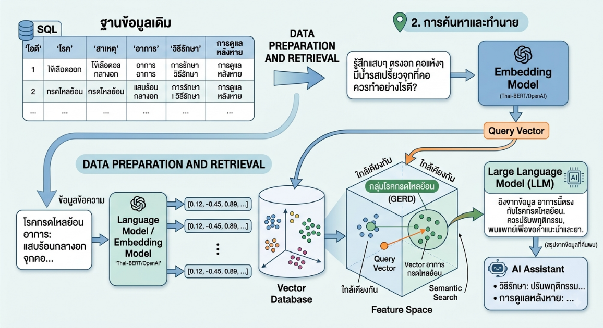

# Lecture 2: ทำความรู้จักแบบจำลองภาษาขนาดใหญ่ (Large Language Model)

## 1. ประเภทของแบบจำลอง (แบ่งตามลักษณะการจำแนกข้อมูล)

แบบจำลองแบ่งออกเป็น 2 ประเภทหลัก ได้แก่ Discriminative Model และ Generative Model

### 1.1 Discriminative Model (แบบจำลองเชิงจำแนก)

Discriminative Model คือแบบจำลองที่เรียนรู้ **ความแตกต่างระหว่างกลุ่มข้อมูล** เพื่อใช้จำแนกว่าข้อมูลหนึ่ง ๆ ควรจัดอยู่ในกลุ่มใด โดยแบบจำลองประเภทนี้ไม่ได้สนใจว่าข้อมูลแต่ละกลุ่มถูกสร้างขึ้นมาอย่างไร แต่สนใจความแตกต่างระหว่างกลุ่มข้อมูลเป็นหลัก

ในการเรียนรู้ แบบจำลองจะค้นหา **ฟังก์ชันสำหรับแยกข้อมูล (Separating Function)** เพื่อสร้างขอบเขตระหว่างกลุ่มข้อมูล

**ตัวอย่าง:** ในกรณีการจำแนกภาพสุนัขและแมว แบบจำลองจะเรียนรู้ลักษณะที่ทำให้สุนัขแตกต่างจากแมว และสร้าง Separating Function เพื่อแบ่งข้อมูลออกเป็นสองกลุ่ม เมื่อได้รับภาพใหม่ แบบจำลองจึงสามารถพิจารณาได้ว่าภาพนั้นควรจัดอยู่ในกลุ่มสุนัขหรือกลุ่มแมว

> **สรุป:** Discriminative Model เรียนรู้ความแตกต่างของข้อมูล เพื่อหา Separating Function สำหรับสร้าง Decision Boundary และนำไปใช้จำแนกข้อมูล

### 1.2 Generative Model (แบบจำลองเชิงกำเนิด)

Generative Model คือแบบจำลองที่เรียนรู้ **รูปแบบหรือลักษณะการกระจาย (Distribution)** ของข้อมูล กล่าวคือศึกษาว่าข้อมูลมีลักษณะอย่างไรและมีรูปแบบร่วมกันอย่างไร

เมื่อแบบจำลองเรียนรู้รูปแบบของข้อมูลได้แล้ว จึงสามารถนำความรู้ดังกล่าวไปใช้ **สร้างข้อมูลใหม่** ที่มีลักษณะใกล้เคียงกับข้อมูลที่ใช้เรียนรู้ เช่น สร้างข้อความ รูปภาพ เสียง หรือข้อมูลประเภทอื่น

ในกรณีของภาษา แบบจำลองมักเรียนรู้จากข้อความจำนวนมากบนอินเทอร์เน็ต โดยใช้วิธีการที่พบทั่วไป ได้แก่
- ปิดคำบางคำแล้วให้แบบจำลองทำนายคำที่หายไป (**Masked Language Modeling**)
- ให้แบบจำลองทำนายคำหรือ Token ถัดไปจากข้อความก่อนหน้า (**Next-token Prediction**)

แบบจำลองเรียนรู้จากการทำนายซ้ำ ๆ บนข้อมูลจำนวนมาก ทำให้ค่อย ๆ เรียนรู้รูปแบบ ความสัมพันธ์ และโครงสร้างของภาษา จนสามารถนำสิ่งที่เรียนรู้ไปใช้สร้างประโยคใหม่ได้

Generative Model โดยเฉพาะแบบจำลองขนาดใหญ่ มักต้องใช้**ข้อมูลจำนวนมากและทรัพยากรในการฝึกฝนสูง**

> **สรุป:** Generative Model เรียนรู้ลักษณะของข้อมูล เพื่อนำไปสร้างข้อมูลใหม่ที่มีลักษณะใกล้เคียงกับข้อมูลต้นแบบ

---

## 2. ภาพรวมกระบวนการพัฒนาแบบจำลองภาษาขนาดใหญ่ (5 ขั้นตอน)

กระบวนการพัฒนาแบบจำลองภาษาขนาดใหญ่แบ่งออกเป็น 5 ขั้นตอนตามลำดับ ได้แก่ การเรียนรู้ภาษา การทำตามคำสั่ง การปรับพฤติกรรมให้สอดคล้องกับมนุษย์ การใช้ข้อมูลภายนอกประกอบการตอบ และการใช้เครื่องมือในการทำงาน

ทั้งนี้ ขั้นตอนที่ 1–3 เกี่ยวข้องกับการฝึกฝนและปรับแต่งแบบจำลองโดยตรง ส่วนขั้นตอนที่ 4–5 เป็นแนวทางในการนำแบบจำลองที่ผ่านการฝึกฝนแล้วไปประยุกต์ใช้สร้างระบบงาน โดยไม่จำเป็นต้องทำครบทั้ง 5 ขั้นตอนเสมอไป

### ขั้นตอนที่ 1: Pretraining — การเรียนรู้ภาษาเบื้องต้น

ขั้นตอนนี้เริ่มจากการนำข้อมูลข้อความจำนวนมหาศาลมาให้แบบจำลองเรียนรู้ โดยในแบบจำลองภาษาแบบ Autoregressive หลักการสำคัญที่ใช้คือ **Next-token Prediction**

**ตัวอย่าง:**
> "วันนี้อากาศร้อนมาก ฉันอยากกิน ___"

แบบจำลองจะเรียนรู้ว่า Token ถัดไปที่เป็นไปได้มีอะไรบ้างจากรูปแบบที่พบในข้อมูล เมื่อทำซ้ำเป็นจำนวนมาก แบบจำลองจึงค่อย ๆ เรียนรู้โครงสร้างภาษา โครงสร้างประโยค ความสัมพันธ์ระหว่างคำ รวมถึงความรู้ที่ปรากฏอยู่ในข้อมูลที่ใช้ฝึกฝน

ในทางปฏิบัติ ผู้พัฒนาระบบมักไม่ทำขั้นตอนนี้เอง แต่เลือกใช้ **Pretrained Model** ที่มีอยู่แล้ว เนื่องจากการทำ Pretraining สำหรับแบบจำลองขนาดใหญ่ต้องใช้ข้อมูลและทรัพยากรจำนวนมาก

> **สรุป:** Pretraining คือขั้นตอนที่ทำให้แบบจำลองเรียนรู้ภาษาและรูปแบบของข้อมูล

### ขั้นตอนที่ 2: Supervised Fine-Tuning (SFT) — การเรียนรู้เพื่อทำตามคำสั่ง

เมื่อแบบจำลองเรียนรู้ภาษาแล้ว ขั้นตอนถัดไปคือการฝึกฝนเพิ่มเติมให้แบบจำลองเข้าใจว่า **เมื่อได้รับข้อมูลนำเข้าแบบใด ควรให้ผลลัพธ์แบบใด** โดยเตรียมข้อมูลเป็นคู่ระหว่างข้อมูลนำเข้าและผลลัพธ์เป้าหมาย (Input, Target Output)

**ตัวอย่างงานแก้ไขไวยากรณ์:**

| ประเภท | ข้อความ |
|---|---|
| Input | She go to school yesterday. |
| Target Output | She went to school yesterday. |

ในขั้นตอนนี้ แบบจำลองยังคงสร้างคำตอบทีละ Token เหมือนเดิม เพียงแต่ระหว่างการฝึกฝนจะมีผลลัพธ์เป้าหมายให้เปรียบเทียบว่าควรตอบอย่างไร

| ขั้นตอน | ลักษณะคำถามหลัก |
|---|---|
| Pretraining | ข้อความถัดไปควรเป็นอะไร |
| SFT | เมื่อได้รับคำสั่งเช่นนี้ ควรตอบอย่างไร |

> **สรุป:** SFT คือขั้นตอนที่ฝึกให้แบบจำลองทำตามงานหรือคำสั่งได้

### ขั้นตอนที่ 3: Alignment — การปรับให้สอดคล้องกับความต้องการของมนุษย์

แม้ผ่านการทำ SFT แล้ว คำตอบที่แบบจำลองสร้างขึ้นก็ยังมีได้หลายแบบ โดยบางคำตอบอาจดีกว่า ชัดเจนกว่า ปลอดภัยกว่า หรือเป็นประโยชน์มากกว่าอีกคำตอบ จึงต้องมีขั้นตอน Alignment เพื่อปรับพฤติกรรมของแบบจำลองให้สอดคล้องกับความต้องการของมนุษย์มากขึ้น

โดยทั่วไป แบบจำลองจะสร้างคำตอบมากกว่าหนึ่งแบบ (เช่น Answer A และ Answer B) แล้วให้มนุษย์ประเมินว่าชอบคำตอบใดมากกว่า ข้อมูล Preference ที่ได้จะถูกนำไปใช้ปรับปรุงแบบจำลองด้วยวิธีการ เช่น

- **RLHF (Reinforcement Learning from Human Feedback):** ใช้ Human Feedback ร่วมกับ Reward Model เพื่อสร้างสัญญาณรางวัล ก่อนนำไปปรับ Policy ของแบบจำลองด้วย Reinforcement Learning
- **DPO (Direct Preference Optimization):** ใช้ข้อมูล Preference ปรับแบบจำลองโดยตรง โดยไม่ต้องผ่านขั้นตอน Reward Model และ Reinforcement Learning แบบ RLHF ดั้งเดิม

> **สรุป:** Alignment คือขั้นตอนที่ปรับพฤติกรรมของแบบจำลองให้ตอบสนองตามความต้องการของมนุษย์มากขึ้น

### ขั้นตอนที่ 4: Retrieval-Augmented Generation (RAG) — การเสริมบริบทจากข้อมูลภายนอก

แม้ผ่านขั้นตอนที่ 1–3 มาแล้ว แบบจำลองยังมีข้อจำกัดอยู่บ้าง เช่น ไม่ทราบข้อมูลที่เกิดขึ้นภายหลังช่วงเวลาการฝึกฝน ไม่มีข้อมูลเฉพาะขององค์กร หรือมีความเสี่ยงเกิด Hallucination จึงเกิดแนวคิด **Retrieval-Augmented Generation (RAG)** ขึ้นเพื่อแก้ไขข้อจำกัดดังกล่าว

หลักการของ RAG คือแทนที่จะให้แบบจำลองภาษาตอบคำถามโดยตรง ระบบจะค้นหาข้อมูลที่เกี่ยวข้องมาให้แบบจำลองก่อน โดยเชื่อมต่อกับ Vector Database

**ตัวอย่างฐานข้อมูล:**

| โรค | สาเหตุ | อาการ | วิธีรักษา | การดูแลหลังหาย |
|---|---|---|---|---|
| กรดไหลย้อน | ... | แสบร้อนกลางอก... | ... | ... |
| ไข้หวัด | ... | ไข้ ไอ... | ... | ... |

ข้อความในฐานข้อมูลจะถูกแปลงผ่าน **Embedding Model** และจัดเก็บเป็น Vector เพื่อใช้ค้นคืนข้อมูลในภายหลัง

เมื่อผู้ใช้ตั้งคำถาม เช่น *"รู้สึกแสบร้อนกลางอกและมีรสเปรี้ยวขึ้นมาที่คอ"* คำถามจะถูกแปลงเป็น **Query Vector** จากนั้นระบบจะทำ **Similarity Search** เพื่อค้นหาข้อมูลที่เกี่ยวข้องมากที่สุด แล้วนำข้อมูลนั้นไปเป็นบริบท (Context) ให้แบบจำลองภาษาใช้ตอบ

> **ข้อสังเกต:** Vector Database ไม่ได้ทำหน้าที่สร้างคำตอบ แต่ทำหน้าที่ค้นหาข้อมูลที่เกี่ยวข้องเท่านั้น ส่วนแบบจำลองภาษาเป็นตัวสร้างคำตอบจากคำถามร่วมกับบริบทที่ค้นคืนได้

RAG ช่วยลดการเกิด Hallucination และทำให้แบบจำลองตอบโดยอ้างอิงข้อมูลเฉพาะที่จัดเตรียมไว้ได้ แต่ไม่ได้รับประกันว่าจะไม่เกิด Hallucination เลย

> **สรุป:** RAG คือการค้นหาข้อมูลที่เกี่ยวข้องมาให้แบบจำลองภาษาใช้ประกอบการตอบคำถาม

### ขั้นตอนที่ 5: Agentic AI — การใช้เครื่องมือและการทำงานหลายขั้นตอน

ขั้นตอนนี้เป็นการขยายความสามารถของแบบจำลองจากการ **ตอบคำถาม** ไปสู่การ **ลงมือทำงานโดยใช้เครื่องมือ (Tools)**

**ตัวอย่าง:** เมื่อผู้ใช้สั่งว่า *"ช่วยเขียน R Code วิเคราะห์ข้อมูลชุดนี้ให้หน่อย"* Agent อาจวางแผนการทำงานตามลำดับดังนี้

1. สร้างชุดคำสั่ง R Code
2. ใช้เครื่องมือรันชุดคำสั่งดังกล่าว
3. พบข้อผิดพลาด (Error)
4. อ่านและวิเคราะห์ข้อผิดพลาด
5. ดำเนินการ Debug ชุดคำสั่ง
6. แก้ไขชุดคำสั่ง
7. รันชุดคำสั่งใหม่อีกครั้ง
8. ได้ผลลัพธ์
9. สรุปผลลัพธ์ให้ผู้ใช้

ข้อสังเกตสำคัญคือกระบวนการนี้สามารถเกิดการทำงานแบบวนซ้ำ (Loop) ได้ โดยจะวนซ้ำจนกว่าจะทำงานสำเร็จหรือถึงเงื่อนไขที่กำหนดให้หยุด

เครื่องมือที่ Agent ใช้มีได้หลายประเภท เช่น ค้นหาข้อมูล รันชุดคำสั่ง เชื่อมต่อ API อ่านไฟล์ ใช้งานฐานข้อมูล หรือเรียกใช้เครื่องมือเฉพาะทางสำหรับงานนั้น ๆ

ทั้งนี้ Agentic AI ไม่ได้หมายความว่าแบบจำลองฉลาดขึ้นจากการฝึกฝนเพิ่มเติมเพียงอย่างเดียว แต่เป็นการออกแบบระบบให้แบบจำลองสามารถ **วางแผนการทำงาน เลือกใช้เครื่องมือที่เหมาะสม พิจารณาผลลัพธ์ และตัดสินใจดำเนินการในขั้นตอนถัดไป** ได้ด้วยตนเอง

> **สรุป:** Agentic AI คือการที่แบบจำลองวางแผนการทำงาน เลือกใช้เครื่องมือ พิจารณาผลลัพธ์ และปรับการทำงานอย่างต่อเนื่องจนบรรลุเป้าหมาย
