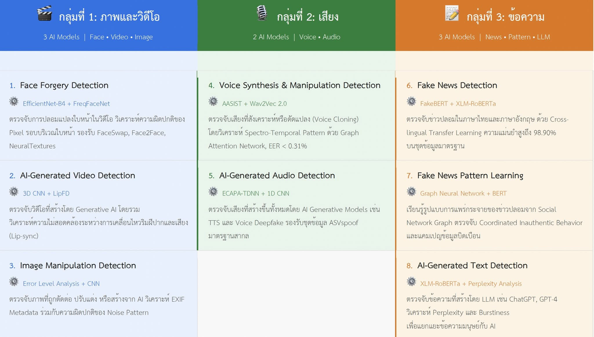

# Research Project: AI Detection

หัวข้อโครงงานวิจัยคือ **AI Detection** แบ่งเป็น 3 กลุ่ม ตามภาพ [assets/ai-detection-overview.jpg](assets/ai-detection-overview.jpg)

| กลุ่ม | ประเภทข้อมูล | หัวข้อย่อย (โมเดลตัวอย่าง) |
|---|---|---|
| 1 | ภาพและวิดีโอ | 1. Face Forgery Detection (EfficientNet-B4 + FreqFaceNet) 2. AI-Generated Video Detection (3D CNN + LipFD) 3. Image Manipulation Detection (Error Level Analysis + CNN) |
| 2 | เสียง | 4. Voice Synthesis & Manipulation Detection (AASIST + Wav2Vec 2.0) 5. AI-Generated Audio Detection (ECAPA-TDNN + 1D CNN) |
| 3 | ข้อความ | 6. Fake News Detection (FakeBERT + XLM-RoBERTa) 7. Fake News Pattern Learning (GNN + BERT) 8. AI-Generated Text Detection (XLM-RoBERTa + Perplexity Analysis) |

## Paper ที่เลือก: Deepfake

เลือกกลุ่ม 1 หัวข้อ Face Forgery Detection (Deepfake) ดูงานที่ทำใน [deepfake-ffdbackbone/](deepfake-ffdbackbone/README.md)
